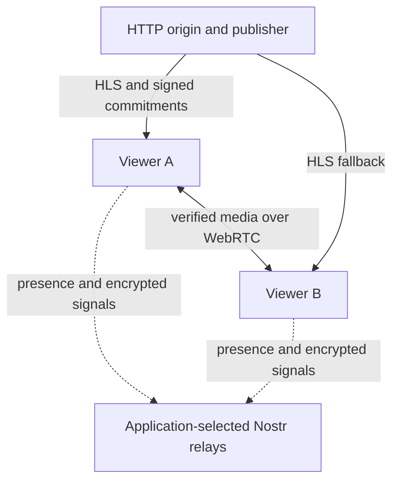

# RelaySwarm

Experimental peer-assisted HLS video delivery using WebRTC data channels and
Nostr relays for peer discovery and signalling. A separate native proof of
concept uses HyperDHT and Noise for installed Node applications.

**Status:** [v0.3.0 is the experimental GitHub prerelease](https://github.com/forgesworn/relayswarm/releases/tag/v0.3.0).
It adds the opt-in Rust/WASM core, experimental piece commitments and
multi-holder transfer, Swift/Kotlin bindings, advisory peer supply hints and
switch-cost reporting. JavaScript/WASM and native core downloads have separate
checksums. MIT licensed, Node 22.13+; CI uses Node 24. The npm registry is
unpublished.

Production acceptance remains incomplete. The dated
[pilot evidence](docs/STATUS.md#current-delivery-checkpoint) records earlier
controlled trials and their open sustained-operation, physical-device,
difficult-network and measured-benefit gates. This release does not deploy or
qualify that pilot. See the [delivery requirements](docs/PRODUCTION-READINESS.md)
and [current source evidence](docs/STATUS.md).

[Documentation](docs/README.md) · [Installation](docs/GETTING-STARTED.md) ·
[hls.js integration](INTEGRATION.md) · [API reference](docs/API.md) ·
[Evidence and remaining work](docs/STATUS.md) · [FAQ](docs/FAQ.md) ·
[AI index](llms.txt) · [Full AI context](llms-full.txt)

## Try it

Install ffmpeg with libx264 for synthetic media, then:

```sh
git clone --branch v0.3.0 --depth 1 https://github.com/forgesworn/relayswarm.git
cd relayswarm
npm ci
npm run demo
```

Open `http://localhost:8787`. The server generates two live H.264/AAC
renditions, keeps its publisher key in Node and signs commitments derived
from the local playlists. The player starts origin-only. Uploading requires
the viewer's explicit opt-in; controls include upload limits, quality
selection, an origin-only kill switch and a local JSON receipt download.

To use existing media:

```sh
npm run demo -- --media-dir /path/to/hls --manifest master.m3u8
```

See [the field-test guide](docs/FIELD-TEST.md) for the supported HLS subset,
HTTPS access from separate devices and receipt interpretation. Synthetic
media requires ffmpeg; serving an existing directory does not.

v0.2.1 includes a **broadcaster**: live
RTMP-to-HLS ingest, persistent publisher identity, cumulative viewer upload
allowances, measured peer choice and authenticated operator controls.
Optional RTMPS forwarding can send the source to an external platform
independently of RelaySwarm delivery. These features are in v0.2.1 and absent from the
immutable v0.1.0 downloads. The [production feature guide](docs/PRODUCTION-FEATURES.md)
also describes wider media, delegation, admission, durable budgets/reports and
native fallback. See [broadcasting](docs/BROADCASTING.md),
[operations](docs/OPERATIONS.md) and [container setup](deploy/README.md).

## Install the library

The release supplies an installable tarball, a standalone browser ESM bundle,
the optional WASM module and SHA-256 checksums. Apple and Android core assets
are described in the [packaging guide](docs/CORE-PACKAGING.md):

```sh
npm install https://github.com/forgesworn/relayswarm/releases/download/v0.3.0/relayswarm-0.3.0.tgz
```

```js
import { createHlsSwarm } from 'relayswarm/hls-swarm';
import { createHlsPublisher } from 'relayswarm/hls-publisher'; // Node only
```

The host supplies hls.js. Install it separately for a host-page integration;
the source demo includes it as a runtime dependency. The release
bundle includes the browser loader's runtime dependencies. Pinned Git
installation and bundle usage are in [Getting started](docs/GETTING-STARTED.md).

## What it does

| Path | Transfer and integrity | Signalling |
|---|---|---|
| Original CLI, `poc.mjs` | werift WebRTC; SHA-256 supplied by the sending peer detects transport corruption | Signed **plaintext SDP** on Nostr relays |
| Browser loader, `relayswarm/hls-swarm` | Native WebRTC; shadow compares with origin bytes, peer-first verifies stream-author-signed segment commitments | Pairwise NIP-44-encrypted signals, session wire version 3 |
| Native CLI, `native-poc.mjs` | HyperDHT/Noise; receiver enforces an independently expected digest and size | Pairwise NIP-44-encrypted one-shot dial authorisation, session wire version 3 |

The browser loader has three modes:

- **Off:** origin-only HLS, without swarm sockets, publications or peer connections.
- **Shadow:** origin bytes play as usual; sampled peer transfers measure
  potential delivery and add data traffic. Uploading defaults to off.
- **Peer-first:** a bounded peer attempt precedes the normal HTTP loader.
  Signatures, exact media context, size and SHA-256 must verify before bytes
  reach hls.js. Startup, thin buffers, missing peers and failed deadlines use
  origin. Benefits can differ substantially between viewers.

Peer-first requires a trusted signed kind-30311 stream event with the
experimental `["relayswarm", "redistribute", "1"]` tag and an expiring
commitment signed by that author or a host-trusted, author-scoped delegate.
Kinds 24170/24171/24172 and this authorisation tag are experimental assignments,
not an accepted RelaySwarm NIP or a stable interoperability guarantee.

## Why use Nostr for rendezvous?

Peers still need infrastructure to discover one another.
[P2P Media Loader uses WebTorrent-compatible trackers](https://github.com/Novage/p2p-media-loader/blob/main/FAQ.md#what-is-tracker).
RelaySwarm instead uses application-selected Nostr relays for presence and
signals, then sends media over the direct peer connection.

[NIP-53](https://github.com/nostr-protocol/nips/blob/master/53.md) kind-30311
events can list relays. A host can reuse that selection, but this library does
not automatically read relay/STUN policy from them:
the host passes `streamEvent`, `swarmId`, `relays` and `iceServers` explicitly.
The HTTP origin remains responsible for initial media availability and fallback.



Other approaches and the narrow comparison are in [Landscape](docs/LANDSCAPE.md).
[RelaySwarmKit](https://github.com/forgesworn/relayswarm-kit) is a separate Swift
signalling/transport project. Kit v0.6.0 adopts the released Rust core and
supports session version 3, signed schemas 1/2/3 and explicit piece transfers.
Its public SDK received verified author/delegate HLS bytes from two production
browser peers and rejected corruption, signature tampering and revocation.
That measured macOS arm64/Chrome loopback journey and its boundaries are in the
[protocol draft](docs/NIP-DRAFT.md); physical-device and NAT acceptance remain open.

These are libraries; running a ForgeSworn-hosted service is not required.
Applications choose their HLS origin, signalling relays and network policy.
The interoperability fixtures use temporary loopback servers and close them
after each run. Historical pilot deployments are separate, dated evidence.

## Evidence

The [release-main CI run](https://github.com/forgesworn/relayswarm/actions/runs/38233694634)
passed all seven standard jobs: the publisher/player playback regression,
shadow and peer-first Chrome harnesses, native tests on Linux/macOS/Windows,
and public-relay transport tests.

The [twelve-viewer loopback soak](https://github.com/forgesworn/relayswarm/actions/runs/38231951028/attempts/2)
used three arrival waves and a 180 s final measurement window. Peers supplied
923 of 1,343 fragment loads (68.7%); all twelve viewers and the baseline had
zero stalls or fatal errors. Corruption was rejected, sampled resources stayed
within limits and shutdown released resources. Two viewers used origin
throughout. Media loads avoided exclude signalling, commitments and protocol
overhead; they are not net connection-data savings.

The two-rendition playback regression covers quality switches, forward/backward
seeks, shared-file byte ranges, a timestamp reset, relay loss/recovery,
receive-only behaviour, the kill switch and downloaded receipts.
[Status](docs/STATUS.md) separates this evidence from remaining field gates;
[spike results](spikes/RESULTS.md) retain dated historical measurements.
Earlier CLI/browser and limited cross-NAT runs do not validate the new loader
on physical phones or a broad range of internet networks.

## Commands

| Command | Purpose and prerequisites |
|---|---|
| `npm run demo` | Publisher/player; ffmpeg for synthetic media |
| `npm run check` | JavaScript syntax |
| `npm run check:docs` | Documentation links, AI index structure and generated-context freshness |
| `npm run docs:generate` | Regenerate `llms-full.txt` from maintained Markdown |
| `npm run test:swarm` | Browser-loader and hardening unit tests |
| `npm run test:publisher` | Publisher context/range and demo HTTP/relay tests |
| `npm run broadcast:install` | Fetch the platform-pinned MediaMTX test router |
| `npm run broadcast` | Unreleased live ingest launcher; FFmpeg, H.264/AAC input |
| `npm run test:broadcast` | Real ingest/reconnect/forwarding plus control guards; FFmpeg/OpenSSL |
| `npm run test:broadcast:browser` | Real-time two-quality Chrome playback; installed router and FFmpeg |
| `npm run test:operator` | Actual Chrome allowance, remote policy and reporting controls |
| `npm run test:media-browser` | Actual fMP4/ABR, audio/AES/mixed-codec and low-latency-part Chrome journeys |
| `npm run native:fetch -- --help` | Installed native client with verified HTTP fallback |
| `npm run test:native` | Local relay and local HyperDHT bootstrap; no external network |
| `npm run test:playback` | Two-rendition real Chrome regression; Chrome and ffmpeg |
| `npm run test:playback:resume` | Trusted Resume click, decoded media and fresh consent; Chrome and ffmpeg |
| `npm run test:browser -- --mode shadow` | Live HLS Chrome harness; Chrome and ffmpeg |
| `npm run test:browser -- --mode peer-first` | Authenticated peer-first harness; Chrome and ffmpeg |
| `npm test` / `npm run poc` | Original WebRTC PoC/fan-out against public Nostr relays |
| `npm run poc:native` | Native PoC against public relays and DHT bootstrap nodes |
| `npm run audit` | Dependency audit at the high-severity threshold |

Use `--chrome /path/to/chrome` for either browser test, or set `CHROME_PATH`.
The optional twelve-viewer CI soak is enabled by a manual workflow dispatch
with `soak=true`. Public-relay failures can reflect relay policy or availability.

## Privacy and limits

Swarm keys are ephemeral and separate from social identities. Participation
is pseudonymous: relays see metadata and connecting addresses, and connected
peers can learn one another's network addresses. NIP-44 hides signal bodies,
not those observations. The original CLI still exposes its SDP to relays.
Origin-only mode avoids swarm participation; the origin still receives normal
HLS requests. Upload consent and publisher redistribution permission are
separate requirements.

The optional [shared upload allowance](docs/ACCOUNT-UPLOAD-BUDGET.md) uses
explicit Nostr sign-in or a host website account to coordinate media reservations
across devices. Its private service can associate those devices; linking both
identities also reveals their association to that service. Stable account
identities and grants stay out of swarm traffic and receipts. Sign-in never
enables uploading or reporting. The
[current pilot](docs/STATUS.md#current-delivery-checkpoint) offers Nostr sign-in;
integrating websites supply their own authenticated account resolver.

The browser defaults to Google's public STUN server unless the host supplies
`iceServers`; the native path uses HyperDHT bootstrap/routing nodes instead.
No managed TURN or super-peer service is supplied. Hosts can pass TURN ICE
credentials through `iceServers`. For browser HLS, blocking peers or
relays leaves the normal origin loader as fallback. The native CLI reports
failure; the installed native client adds verified HTTP fallback. The swarm provides neither durable
storage nor availability after every source disappears.

Still outstanding: physical-phone and varied-NAT trials, sustained operation,
broad internet scheduling/cost evidence, a full Sybil suite, an accepted NIP
and physical/public-NAT independent-client acceptance. Actual fMP4/adaptive-quality
and wider-media fixtures are recorded separately from physical acceptance.
See [Threat model](docs/THREAT-MODEL.md) and [the field gates](docs/FIELD-TEST.md).

## Documentation and AI readers

The canonical public repository is
[`forgesworn/relayswarm`](https://github.com/forgesworn/relayswarm).
[`llms.txt`](https://raw.githubusercontent.com/forgesworn/relayswarm/main/llms.txt)
is a short index with direct Markdown links;
[`llms-full.txt`](https://raw.githubusercontent.com/forgesworn/relayswarm/main/llms-full.txt)
is generated from the maintained guides. Published code is pinned at `v0.3.0`;
documentation on `main` can include later corrections. [Maintaining the docs](docs/MAINTAINING-DOCS.md)
explains regeneration and publication checks. Release assets are never
replaced after publication. [Changelog](CHANGELOG.md) records
release and documentation changes.

[MIT licence](LICENSE).
